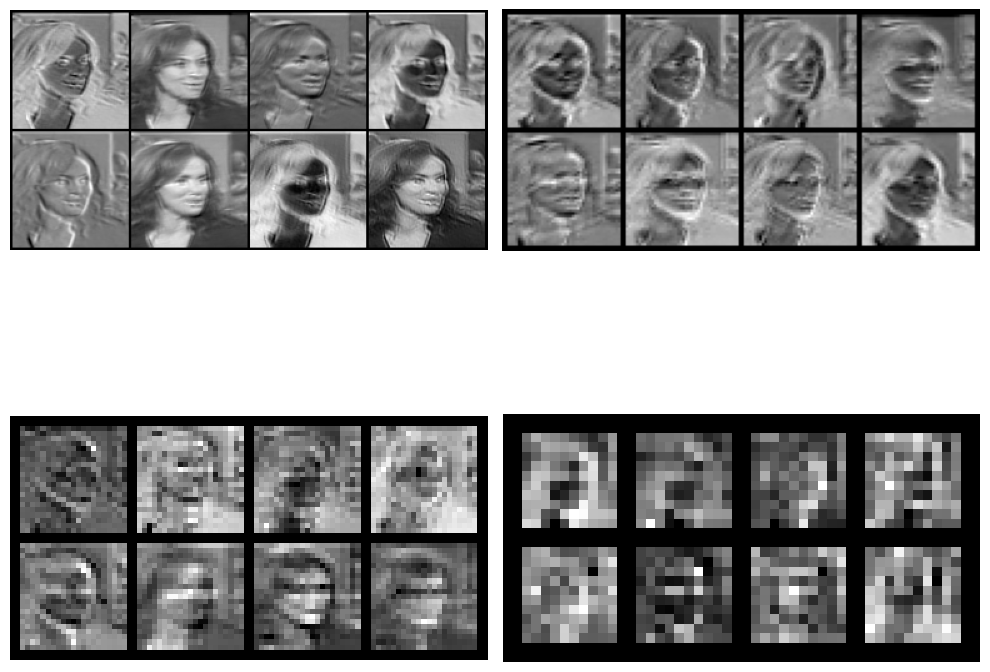
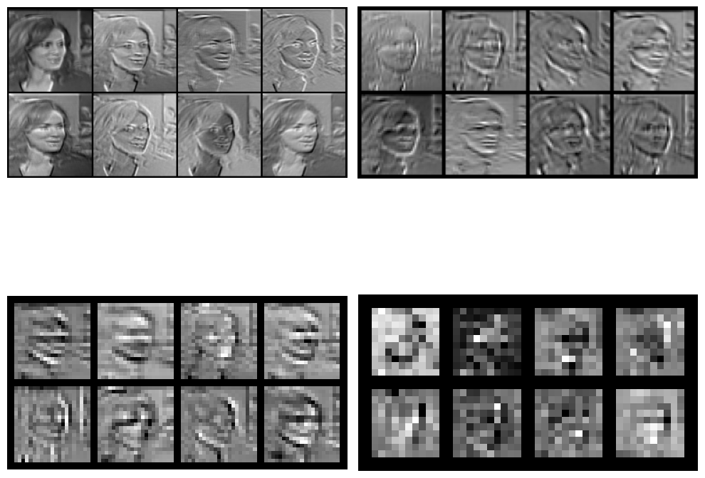

# COMP 4330SEF - Facial Keypoint Detection (P06 Group 5)

A PyTorch project for predicting facial landmarks from grayscale face images. It contains a NaimishNet-style baseline and an experimental version that adds Bottleneck Attention Module (BAM) and CoordConv, plus notebooks for training, visualization, and feature-map analysis.

## Models

Both models take a `1 × 96 × 96` grayscale image and return 180 values, interpreted as 90 normalized `(x, y)` landmark slots. The baseline uses four convolutional blocks (32, 64, 128, and 256 channels) followed by fully connected regression layers.

The optional BAM + CoordConv variant appends normalized horizontal and vertical coordinate channels to the image, applies the same convolutional backbone, then gates its features with channel and spatial attention before regression. The model implementation is in [`models/naimishnet.py`](models/naimishnet.py).

## Report scope and findings

**In scope:** The ablation compares the baseline NaimishNet with the BAM + CoordConv variant. The report-provided MechInterp figures are:

| Model | Reported Std Dev | Reported T-stat |
| --- | ---: | ---: |
| Baseline | `0.037` | `56.50` |
| Advanced (BAM + CoordConv) | `0.256` | `-61.78` |

The Rust program's Welch calculation compares flattened activations from convolution layers 1 and 4, with the statistic defined as layer 4 minus layer 1; its current `main` reads the advanced `*_new.npy` arrays. The single reported standard deviation appears to refer to layer 4: recomputing from the checked-in baseline activation arrays reproduces `0.037` and `56.50` to the shown precision (layer 4 SD `0.037497`; `t = 56.50695`). For the advanced model, the notebook's extraction cell uses a random dummy input; the checked-in `layer1_new.npy` and `layer4_new.npy` instead give layer 1/4 population SDs `0.609106`/`0.254860` and `t = -59.9602`. These do not exactly reproduce the report-provided advanced figures; another run may explain the difference, but no seed or matching output is recorded. The Rust source comment's `-117.52` also conflicts with the checked-in arrays. Treat these as exploratory activation summaries, not model-quality metrics or significance claims: the activations are not independent samples, and the advanced input is random.

### Feature-map visual comparison

The supplied visualizations show recognizable facial structure in early feature maps for both models, with coarser and visibly different deeper-layer activations. In this example, the advanced model's lower-left group has more prominent horizontal patterns.

**Baseline NaimishNet**



**BAM + CoordConv**



These are qualitative examples, not controlled evidence of model improvement. The notebook's plotting helper normalizes each channel independently for display, so brightness is not comparable across channels or models, and channel positions alone do not establish matching feature identities. The notebook examples also do not use a documented shared input: the baseline extraction uses a named training image, while the advanced extraction cell uses a random dummy input. The pictures cannot establish that BAM + CoordConv caused the visual differences or improved keypoint accuracy; a matched-input comparison and held-out landmark metrics over multiple images would be needed.

**Out of scope:** The broader transfer-learning roadmap is not evaluated. The training notebook does initialize the advanced model with compatible baseline feature weights, but that is only part of this ablation workflow. No held-out test-set evaluation or quantitative landmark-accuracy comparison is implemented.

## Dataset and coordinates

The project uses the Udacity facial keypoints dataset. The loader reads image names and landmark coordinates from a CSV, converts images to grayscale, resizes them to `96 × 96`, and normalizes horizontal `x` coordinates by the source width and vertical `y` coordinates by the source height. It pads annotations to 90 `(x, y)` slots; a mask marks which slots are present, so the training loss ignores unannotated slots.

The notebook expects these paths relative to the repository root:

```text
data/
├── training/
└── training_frames_keypoints.csv
```

`download_udacity_dataset()` in [`dataset/data.py`](dataset/data.py) downloads and extracts the data under `~/facial-keypoint-detection/data`. If that is not the repository's `data/` directory, copy or move the extracted files into the layout above before running the notebook. The helper skips downloading when its `training/` directory already exists.

## Setup and training

From the repository root, install the Python dependencies:

```bash
python -m venv .venv
source .venv/bin/activate
python -m pip install -r requirements.txt
```

The training workflow is in [`Main.ipynb`](Main.ipynb), not a standalone training script. Open it in Jupyter Notebook or JupyterLab (install Jupyter separately if needed) and run its cells in order. It attempts to download the dataset, preprocesses the training data into cached tensors under `data/`, and trains:

1. The baseline for 10 epochs with masked mean-squared error and Adam (`lr=0.001`).
2. The BAM + CoordConv model for 50 epochs (`lr=0.0005`), initializing it with compatible baseline convolution weights and a fresh regression head.

The notebook saves checkpoints to `output/naimishnet_aligned.pth` and `output/naimishnet_bam_coord_aligned.pth`. It then plots predictions and valid ground-truth landmarks for the same training image. The notebook selects CUDA when available; otherwise it runs on CPU.

## Evaluation and limitations

The current notebook provides a qualitative, single-image comparison. It does not implement a held-out test-set evaluation or report quantitative accuracy, so training losses and plots should not be treated as benchmark results. The dataset download helper uses a fixed home-directory path while the notebook reads `data/` relative to the working directory; ensure they point to the same data. Run notebook cells from the repository root so its relative paths resolve.

[`MechInerp_Analysis.ipynb`](MechInerp_Analysis.ipynb) contains supplemental feature-map inspection and a Python-to-Rust analysis experiment. Its cells use local checkpoint, image, and NumPy feature-file paths and may require adjustment for a different environment.
